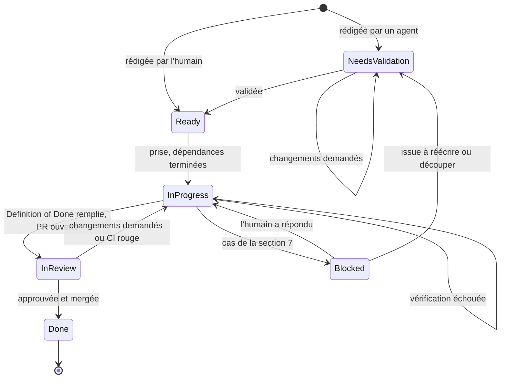

# Le graphe

Le parcours d'une issue, de sa rédaction à son merge : les étapes, qui agit,
ce qui fait passer à l'étape suivante, et comment on le voit sur GitHub.

## Les étapes

### Needs validation

- **Sur GitHub** : issue ouverte, label `needs-validation`, posé à la
  création (voir `docs/workflow/issues.md`). Une issue rédigée par l'humain
  passe directement à **Ready** : il retire le label.
- **Qui agit** : l'humain par défaut, ou un autre agent que l'auteur si
  l'humain l'a demandé.
- **Pour en sortir** : validée, le valideur retire le label → **Ready**. Si
  des changements sont demandés, l'auteur reformule et l'issue reste ici.

### Ready

- **Sur GitHub** : issue ouverte, sans label `needs-validation` ni `blocked`,
  sans personne assignée.
- **Qui agit** : l'humain confie l'issue à un agent. Un agent ne prend
  lui-même une issue `Ready` que si l'humain le lui a demandé.
- **Pour en sortir** : l'agent s'assigne l'issue et crée la branche →
  **In progress**. Si l'issue dépend d'autres issues, celles-ci doivent être
  terminées.

### In progress

- **Sur GitHub** : issue assignée, sans PR. Après une review, la PR reste
  ouverte avec des changements demandés.
- **Qui agit** : l'agent à qui l'issue est confiée.
- **Ce qu'il fait** : le cycle de la section 3 d'`AGENTS.md`. Si une
  vérification échoue, il corrige et recommence.
- **Pour en sortir** : la Definition of Done est remplie, l'agent ouvre
  la PR → **In review**. Un cas de la section 7 → **Blocked**.

### Blocked

- **Sur GitHub** : label `blocked`, et un commentaire qui pose la question au
  format de la section 7.
- **Qui agit** : l'humain.
- **Pour en sortir** : l'humain répond, l'agent retire le label →
  **In progress**. Si l'issue doit être réécrite ou découpée →
  **Needs validation**.

### In review

- **Sur GitHub** : PR ouverte, liée par `Closes #N`. La CI la refuse si
  l'issue porte `needs-validation` ou `blocked`.
- **Qui agit** : la review est faite par l'humain par défaut, ou par un
  autre agent que l'auteur de la PR si l'humain l'a demandé. L'auteur traite
  les retours.
- **Pour en sortir** : des changements sont demandés ou la CI échoue →
  **In progress**, sur la même PR. Review approuvée et CI verte → merge →
  **Done**.

### Done

- **Sur GitHub** : PR mergée, issue fermée automatiquement.
- **Qui agit** : le merge est fait par l'humain par défaut, ou par un agent
  si l'humain l'a demandé.

## Règles

- **Un agent ne valide jamais son propre travail** : ni l'issue qu'il a
  écrite (il n'en retire pas `needs-validation`), ni la PR qu'il a ouverte.
- **Une issue = un seul agent à la fois.**
- **Plusieurs agents peuvent avancer en parallèle** sur des issues
  indépendantes, chacun avec sa branche et sa copie de travail.
- **L'humain peut fermer une issue à tout moment** : le parcours s'arrête là.
- **Une parent issue est terminée** quand toutes ses sub-issues le sont.
